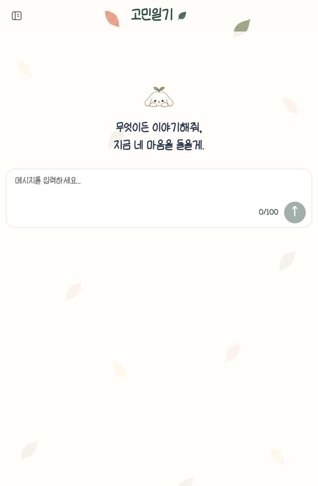
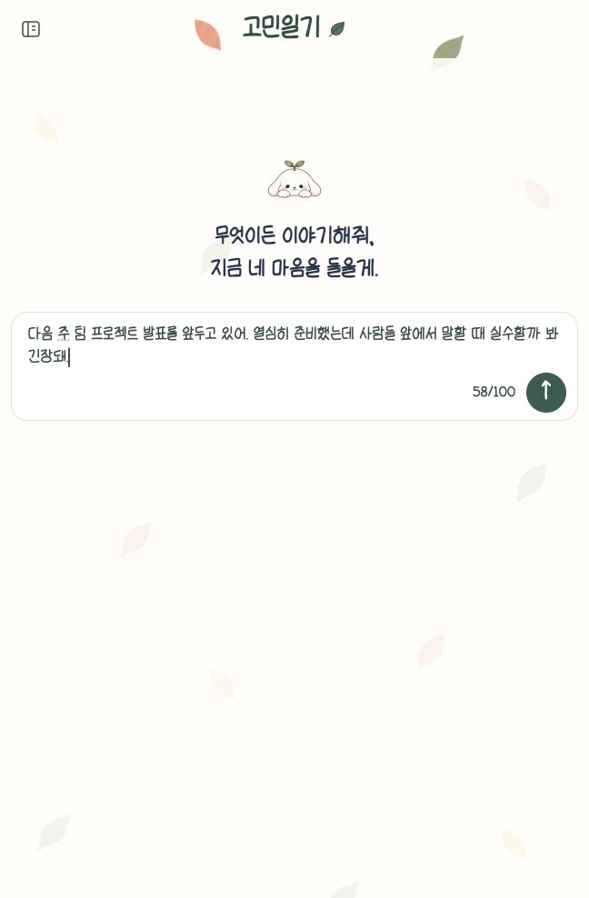
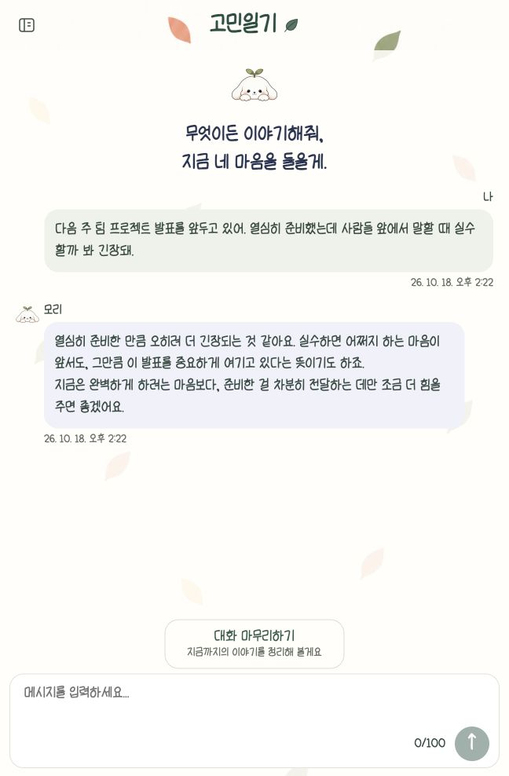
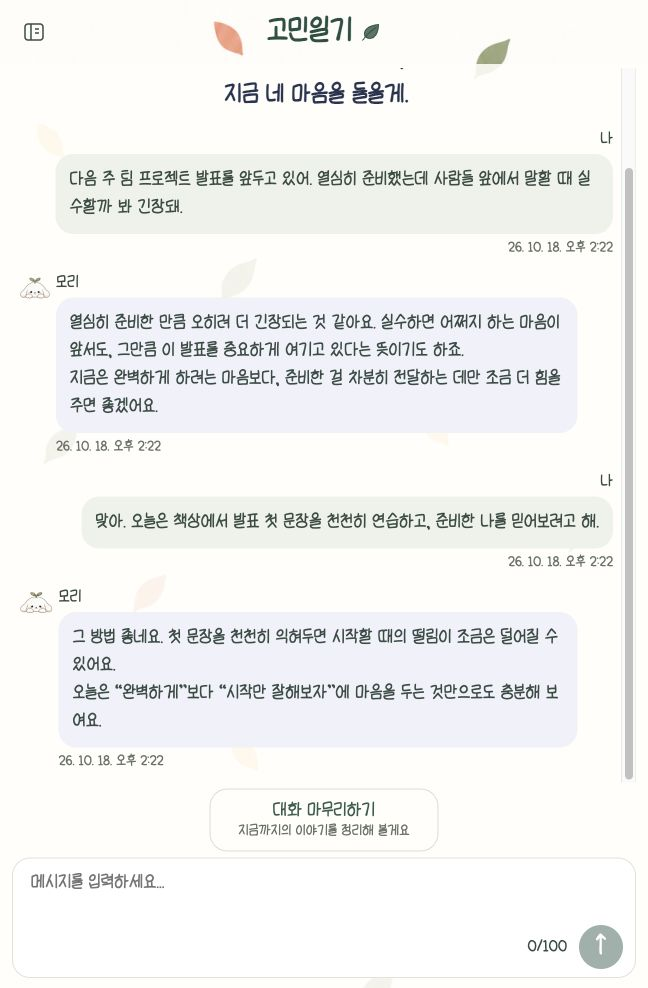
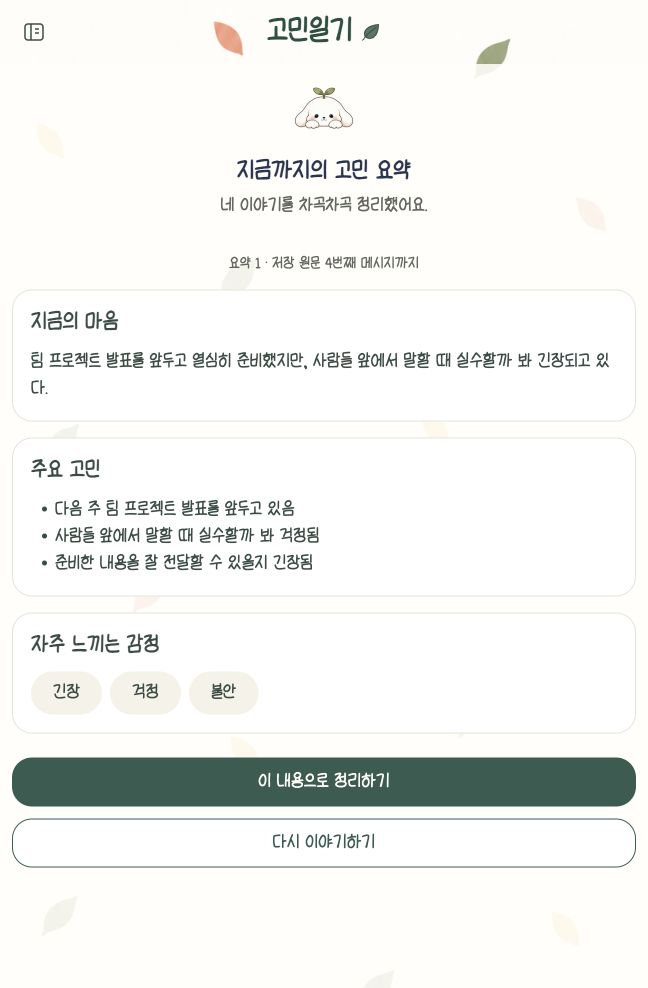
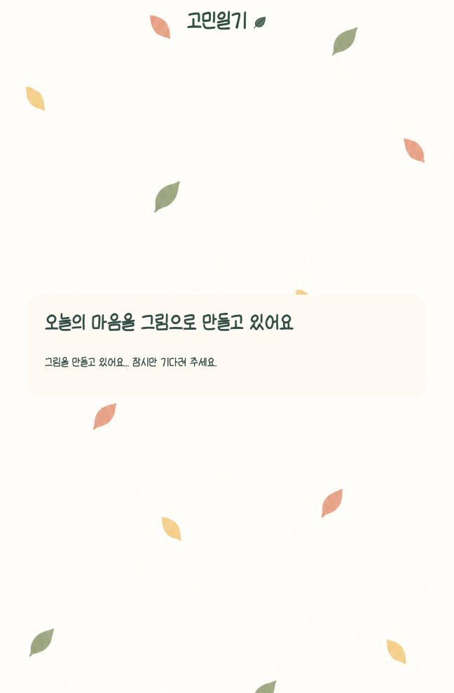
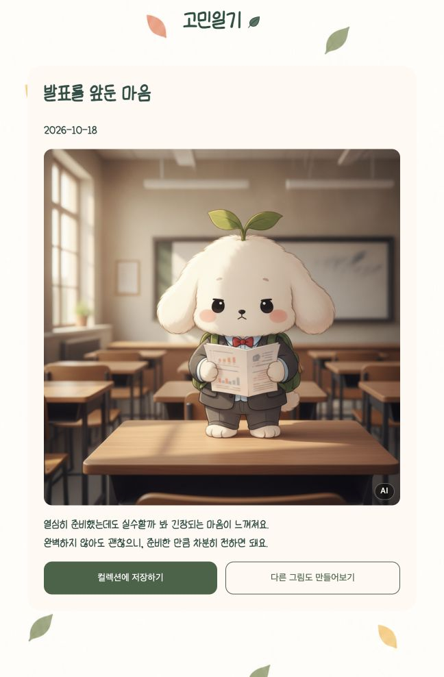
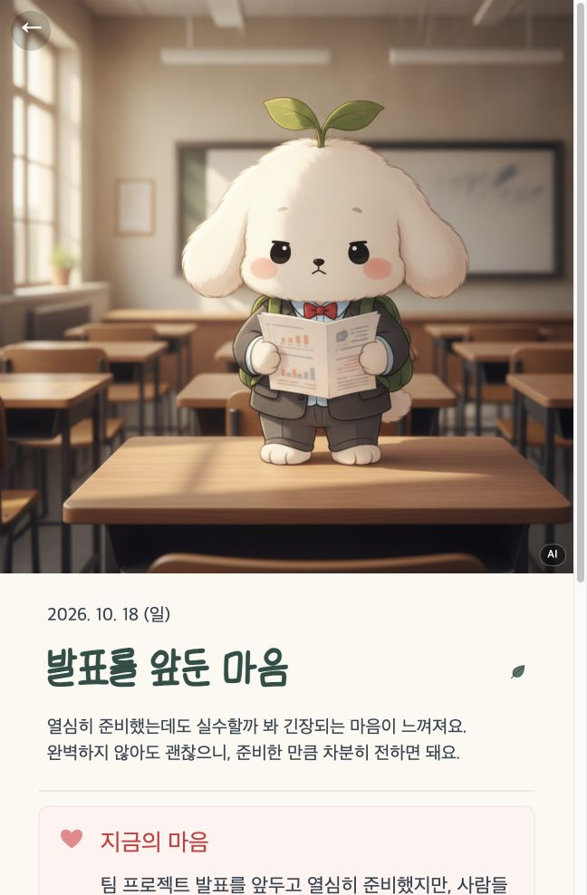
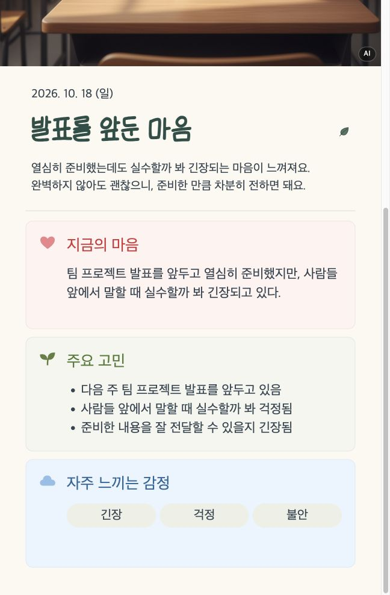
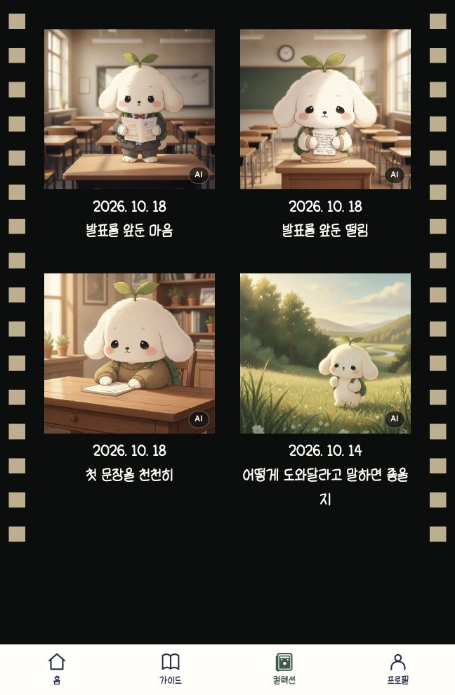

# 서비스 시연 자료

- [발표자료 PPTX](../gomin-presentation.pptx)
- [발표자료 Google Slides](https://docs.google.com/presentation/d/1Kepse_Rnh3sg62i3V0yE0dS6p29cXhsR/edit)

## 시연영상

- [gomin-service-demo.mp4](gomin-service-demo.mp4)
- 52.25초 · 1920×1080 · H.264 MP4 · 24fps · 무음
- 홈 → 고민 입력 → AI 대화 → 내 마음 확인 → 그림일기 생성 → 컬렉션 저장·조회

## 단계별 화면

| 순서 | 화면 | 확인 내용 |
| --- | --- | --- |
| 1 | [홈](screenshots/01-home.jpg) | 홈에서 털어놓기로 이동 |
| 2 | [대화 시작](screenshots/02-talk-start.jpg) | 모리와 대화 시작 |
| 3 | [고민 입력](screenshots/03-message-input.jpg) | 발표를 앞둔 걱정 입력 |
| 4 | [첫 응답](screenshots/04-reply-read.jpg) | 모리의 응답 확인 |
| 5 | [이어진 대화](screenshots/05-followup-reply.jpg) | 고민을 구체적으로 털어놓기 |
| 6 | [내 마음 확인](screenshots/06-summary-read.jpg) | 현재 마음·주요 고민·감정 확인 |
| 7 | [그림일기 생성 중](screenshots/07-image-loading.jpg) | 요약을 바탕으로 그림일기 생성 |
| 8 | [그림일기 완성](screenshots/08-diary-result.jpg) | AI 배지가 표시된 생성 결과 확인 |
| 9 | [컬렉션 저장](screenshots/09-collection-save.jpg) | 저장한 그림일기의 상세 화면 확인 |
| 10 | [컬렉션 상세](screenshots/10-collection-summary.jpg) | 저장한 고민과 감정 확인 |
| 11 | [컬렉션 목록](screenshots/11-collection-list.jpg) | 고정 감정 카테고리가 제거된 목록 확인 |

### 1. 홈

### 2. 대화 시작

### 3. 고민 입력

### 4. 첫 응답

### 5. 이어진 대화

### 6. 내 마음 확인

### 7. 그림일기 생성 중

### 8. 그림일기 완성

### 9. 컬렉션 저장

### 10. 컬렉션 상세

### 11. 컬렉션 목록

[프로젝트 문서](../README.md)
