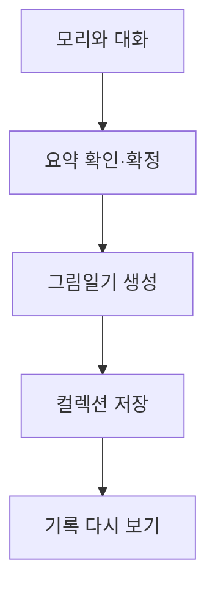

# 고민일기 — 말로 풀고, 그림으로 남기는 오늘의 마음

고민일기는 혼자 글로 정리하기 어려운 마음을 AI 친구 ‘모리’와의 대화로 풀어내고, 한 장의 그림일기로 남기는 웹 서비스다. 사용자가 이야기를 건네면 모리는 앞선 대화를 바탕으로 공감하고 생각을 정리하도록 돕는다. 대화를 마친 뒤에는 주요 고민과 감정을 요약하고, 그 내용을 모리가 등장하는 그림과 짧은 위로 문구로 담아낸다. 마음에 드는 기록은 컬렉션에 저장해 다시 볼 수 있다.

## 만들고 싶은 경험

“마음은 복잡한데, 무엇부터 써야 할지 모르겠다.”

고민일기는 이런 순간에 말을 건넬 수 있는 대화 상대에서 출발했다. 잘 정리된 문장을 준비하지 않아도 자신의 이야기를 시작하고, 대화를 통해 지금의 마음을 살펴볼 수 있도록 했다. 긴 대화가 끝난 자리에는 요약과 그림일기가 남는다. 사용자가 그날의 고민을 자신의 기록으로 간직하도록 돕는 것이 서비스의 목표다.

1차 대상은 **심리 상담을 받고 싶거나 받고 있는 만 10~24세 청소년·청년**이다. 학업, 진로, 관계처럼 일상에서 마주하는 고민을 표현하고 기록하는 경험에 초점을 맞췄다. AI 응답은 진단이나 치료를 단정하지 않도록 구성했다.

## 이용 흐름

로그인 후 이용하며, 요약을 확정하기 전에는 대화를 이어갈 수 있다. 생성된 그림이 마음에 들지 않으면 같은 요약으로 다른 그림을 만들 수 있다.

### 단계별 설명

1. 회원가입·로그인 후 **털어놓기**에서 모리에게 이야기를 건넨다.
2. 모리는 이전 대화를 바탕으로 응답한다. 사용자가 원할 때 함께 방법을 생각하고, 공감을 원할 때는 이야기에 귀를 기울인다.
3. 대화를 마무리하면 **지금의 마음·주요 고민·감정 태그**를 확인한다. 더 이야기하고 싶다면 같은 대화로 돌아가 이어갈 수 있다.
4. 요약을 확정하면 제목·위로 문구와 함께 모리가 등장하는 그림일기를 만든다. 같은 요약으로 다른 그림을 만들 수도 있다.
5. 마음에 드는 결과를 **컬렉션**에 저장하고, 그림과 요약을 다시 살펴본다.

## AI를 활용하는 방식

| 단계 | AI의 역할 |
| --- | --- |
| 대화 | 저장된 대화의 맥락을 반영해 공감하거나 생각을 정리하는 질문·제안을 건넨다. |
| 요약 | 현재 대화에서 드러난 고민과 감정을 세 영역으로 정리한다. |
| 그림일기 구성 | 확정한 요약으로 제목·위로 문구·그림의 장면을 구성한다. |
| 이미지 생성 | 장면 설명과 모리 참조 이미지를 바탕으로 그림을 만든다. |

AI는 서비스의 대화 상대이자 기록을 만드는 도구다. 사용자가 고민을 표현하는 과정부터 결과를 남기는 과정까지 이어진다.

## 기술 구성

| 영역 | 사용 기술 |
| --- | --- |
| 웹 화면 | Next.js, React, TypeScript |
| 서버 | Python, FastAPI, Uvicorn |
| 대화·요약·텍스트 구성 | 네이토를 통한 생성형 AI 호출 |
| 이미지 생성 | Gemini API |
| 데이터·파일 저장 | Supabase PostgreSQL, Supabase Storage |
| 배포 구성 | Vercel, Render |

자세한 구성은 [시스템 아키텍처](../../ARCHITECTURE.md), 실행 방법은 [프로젝트 실행 안내](../../../README.md)를 참고한다.

## 팀 Happy Ending

고민을 정리하며 오늘 하루를 해피엔딩으로 마무리하자는 뜻으로 팀 이름을 정했다. 네 명이 함께 기획하고, 기능별로 개발과 검증을 나눴다.

| 팀원 | 담당 업무 |
| --- | --- |
| 김영규 | 회원·인증 기능 |
| 김효원 | 모리와의 대화, 대화 마무리·요약, 확정 요약 전달 |
| 김지민 | 그림일기 생성·재생성, 결과 저장, 컬렉션 목록·상세 |
| 선우진 | 요구사항 기반 QA와 전체 이용 흐름 검증 |

## 초기 사용자 피드백과 개선

실사용자 **5명**에게 서비스를 제공하고 이용 과정에서 불편했던 점과 AI 결과에 관한 의견을 받았다. 테스트는 기획 타겟과 다른 사용자들을 대상으로 진행했으며, 서비스 이용 흐름과 AI 결과를 점검하는 데 활용했다.

- 입력창에 바로 쓸 수 있도록 자동 초점을 적용하고, 초록색 테두리를 정리했다.
- PC 컬렉션 상세에서 그림은 왼쪽, 요약은 오른쪽에 배치했다.
- 다음 고민을 유도하는 정형적인 응답을 줄이도록 대화 프롬프트를 수정했다.
- 그림이 고민과 동떨어지지 않도록 요약의 상황·행동·감정을 장면에 반영하도록 수정했다.
- 대화·컬렉션을 기다리는 동안 상태를 알 수 있도록 스켈레톤과 로딩 스피너를 추가했다.

위 내용은 수정 내역을 정리한 것으로, 개선 효과를 수치로 측정하거나 타겟 사용자에게 재검증한 결과는 아니다. 전체 피드백과 반영 근거는 [사용자 피드백과 개선 결과](user-testing.md)에 정리했다.

## 프로젝트 자료

- [배포 서비스](https://www.gomin.today)
- [GitHub 저장소](https://github.com/gomin-diary/gomin)
- [프로젝트 기획서](../proposal.md)
- [설치·실행 안내](../../../README.md)
- [검증·배포 결과](verification.md)
- [사용자 테스트 결과](user-testing.md)
- [전체 프로젝트 자료](../README.md)

## 참고 자료

- [팀 역할](https://younkim.atlassian.net/wiki/spaces/GOMIN/pages/622611)
- [대화·요약 요구사항](https://younkim.atlassian.net/browse/GOMIN-71)
