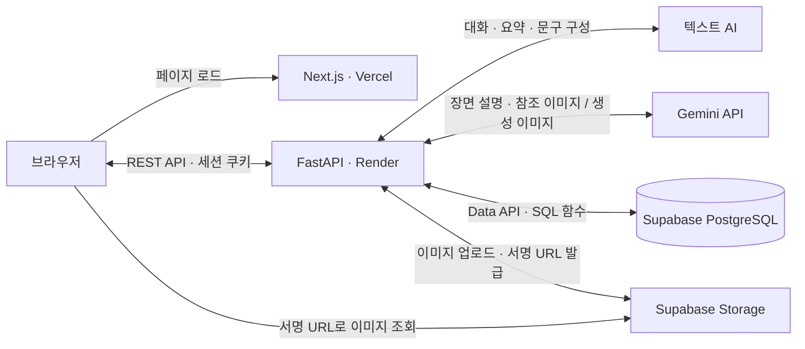
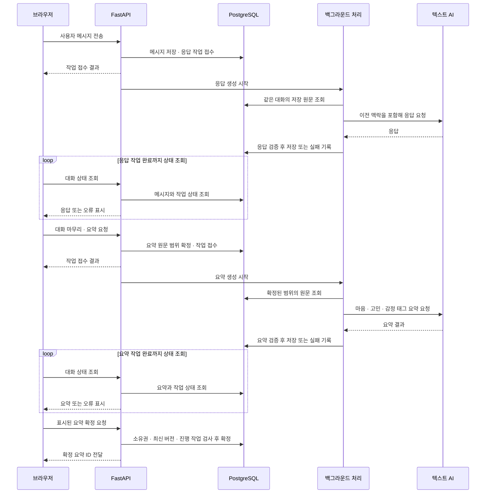
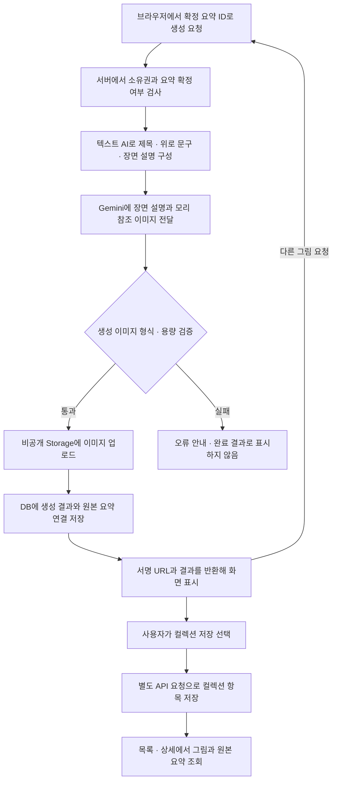

# 시스템 아키텍처

기능 요구사항을 지원하는 시스템 구성과 AI 처리 흐름을 정리한다. 기술 스택과 저장소 구조의 상세는 [공통 시스템 아키텍처](../../ARCHITECTURE.md)를 참고한다.

각 기술을 선택한 배경은 [기술 스택 선정 이유](../technology-selection.md)에 정리했다.

## 시스템 구성

브라우저는 Next.js 화면을 표시하고 FastAPI에 API를 요청한다. FastAPI는 세션과 데이터 소유권을 확인한 뒤 AI 호출, DB 조회·저장, 이미지 업로드를 처리한다. Supabase는 PostgreSQL과 파일 저장소를 제공하며, 회원 인증은 Supabase Auth가 아닌 FastAPI에서 처리한다.

| 영역 | 구성과 역할 |
| --- | --- |
| 화면 | Next.js·React·TypeScript, 공통 API 호출과 세션 쿠키 사용 |
| 서버 | Python·FastAPI·Uvicorn, 인증·AI·저장 처리 |
| 텍스트 AI | 네이토 API로 대화·요약·그림일기 문구 구성 |
| 이미지 AI | Gemini API로 모리 참조 이미지와 장면 설명을 이용한 생성 |
| 데이터 | Supabase PostgreSQL과 Data API, SQL 함수로 권한·저장 제약 처리 |
| 파일 | Supabase Storage의 비공개 이미지와 서명 URL |
| 배포 | Vercel의 프론트엔드, Render의 백엔드 |

## 대화와 요약

대화는 REST API로 처리한다. 사용자 메시지를 저장하면 서버는 응답 작업 접수를 알리고 백그라운드에서 AI를 한 번 호출한다. 브라우저는 대화 상태를 주기적으로 조회해 완성된 응답이나 오류를 확인한다. 토큰 스트리밍·WebSocket·SSE는 사용하지 않는다.

모리는 해당 대화에 저장된 사용자·AI 발화를 순서대로 전달받는다. 사용자 ID·이메일·작성 중인 초안은 프롬프트에 넣지 않는다. 요약은 정해진 원문 범위에서 지금의 마음·주요 고민·감정 태그를 만들고, 서버가 출력 구조와 빈 값을 검사한다.

사용자가 더 이야기하면 같은 대화에서 새 요약을 만든다. 확정할 때는 소유권, 최신 요약인지, 진행 중인 작업이 있는지 검사한다. 확정 성공과 이미지 생성·컬렉션 저장 성공은 각각 구분한다.

## 그림일기 생성

확정한 요약의 세 영역으로 제목·위로 문구·장면 설명을 구성한다. 이미지 모델에는 장면 설명과 모리 참조 이미지를 전달한다. 생성한 이미지의 실제 형식·용량을 검사한 뒤 비공개 Storage에 업로드하고 DB에 결과를 저장한다.

그림일기 생성은 한 HTTP 요청 안에서 실행한다. 대화·요약의 백그라운드 작업과 달리 이미지 작업 큐나 상태 폴링을 사용하지 않는다. 재생성은 같은 요약으로 새 결과를 만들며 이미 저장한 컬렉션 항목을 삭제하지 않는다.

## 프롬프트 개선

| 사용자 의견 | 프롬프트에 반영한 기준 |
| --- | --- |
| 다음 고민을 유도하는 대화가 불편하다. | 사용자가 주제를 바꾸기 전에는 현재 고민에 머문다. 필요한 때만 한 번에 하나씩 질문하고 마무리 의사를 존중한다. |
| 응답이 정형적이다. | 공감·질문·제안을 매번 같은 순서로 넣지 않는다. 공감만 원하는 경우 조언을 덧붙이지 않는다. |
| 그림이 고민과 무관하게 느껴진다. | 요약의 핵심 상황을 장소·행동·복색과 연결하고, 표정·몸짓으로 감정을 표현한다. 자연 풍경을 강제하지 않는다. |

AI가 사용자가 말하지 않은 사건이나 사실을 만들거나 진단·치료를 단정하지 않도록 지시한다. 그림의 시각적 묘사를 제목·위로에서 실제 경험처럼 설명하지 않도록 구성했다.

## 데이터와 접근 제어

대화·메시지·요약을 연결하고 생성 결과는 원본 요약을 참조한다. 컬렉션은 저장한 결과를 참조하므로 이후 대화에서 새 요약이 만들어져도 기존 그림일기의 원본 요약은 바뀌지 않는다.

보호 API는 서버에서 확인한 회원 ID를 사용한다. DB 테이블·함수 권한을 서버 역할로 제한하고, 이미지 파일 경로를 DB에 보관한다. 브라우저에는 소유권 확인 후 발급한 서명 URL을 전달한다.

## AI 활용 범위

텍스트와 참조 이미지를 입력해 그림을 만드는 멀티모달 처리가 구현되어 있다. 요약에서 문구·장면을 구성하고 이미지 생성·파일 저장·결과 저장으로 이어지는 처리 흐름도 코드에 존재한다.

외부 지식 검색을 이용하는 RAG나 AI가 도구를 선택하는 Agent 구조는 확인되지 않았다. 저장된 같은 대화를 복원해 사용하는 기능을 별도 사용자 선호 메모리로 설명하지 않는다.

## 참고 자료

- [시스템 아키텍처](../../ARCHITECTURE.md)
- [대화·요약 구현](../../engineering/talk-mvp.md), [그림일기 구현](../../engineering/diary-mvp.md)
- [대화 AI 어댑터](../../../backend/app/talk/provider.py), [대화 작업 실행](../../../backend/app/talk/service.py)
- [그림일기 문구·장면 구성](../../../backend/app/diary/composition.py), [그림일기 API](../../../backend/app/api/routes/diary.py)
- [대화 개선 PR #52](https://github.com/gomin-diary/gomin/pull/52), [이미지 프롬프트 개선 PR #51](https://github.com/gomin-diary/gomin/pull/51)

[기능 요구 명세서](README.md) · [프로젝트 문서](../README.md)
